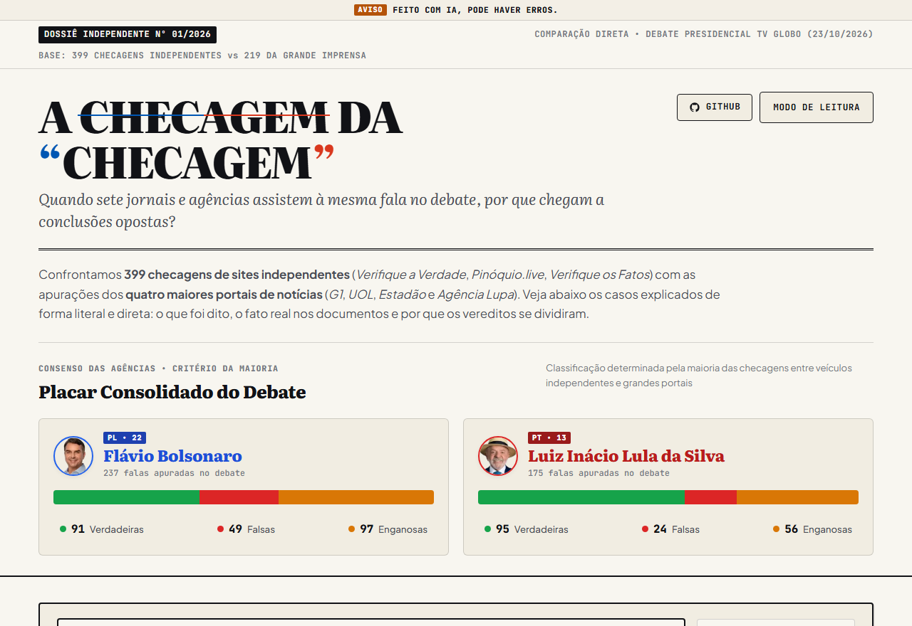
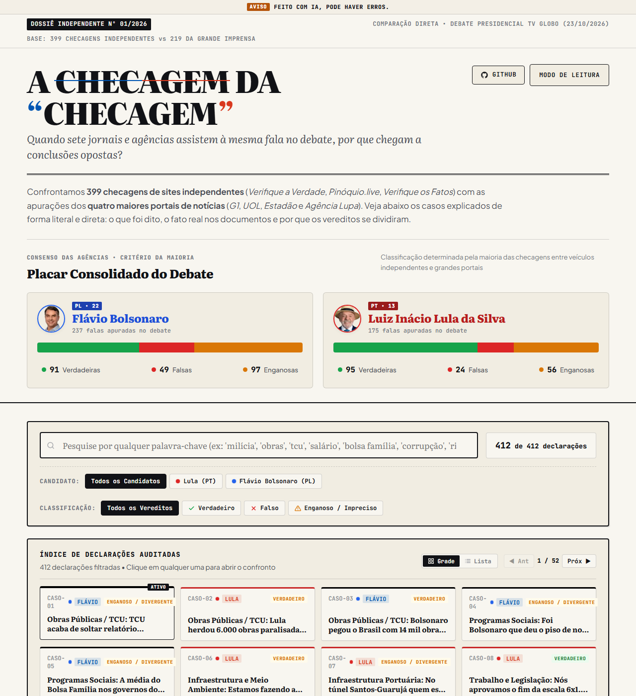
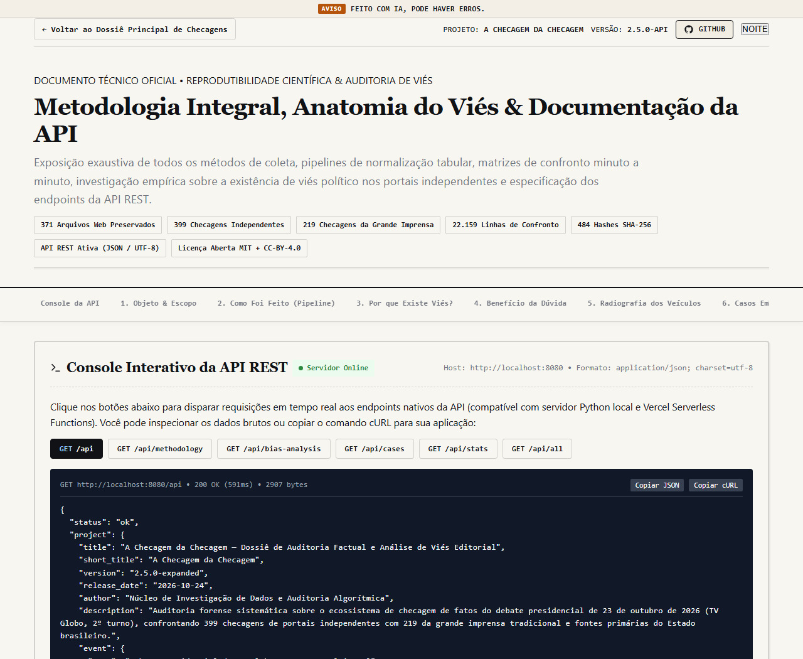
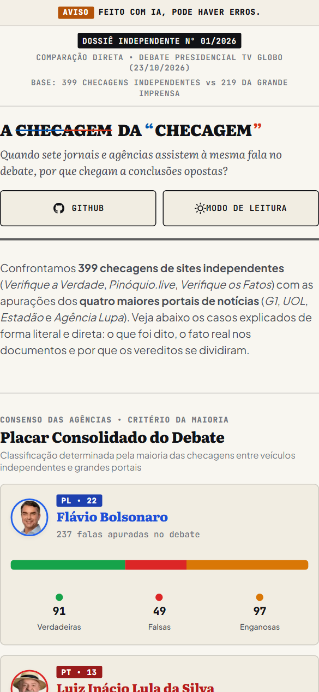

# A Checagem da Checagem

> **Dossiê de Auditoria Estrutural e Confronto Factual Comparado**  
> *Debate Presidencial TV Globo — 2º Turno das Eleições 2026 (23 de Outubro de 2026)*

[](LICENSE)
[](https://creativecommons.org/licenses/by/4.0/)
[]()
[]()
[]()
[]()

---

## Sumário

1. [Visão Geral](#visão-geral)
2. [Demonstração da Interface](#demonstração-da-interface)
3. [Arquitetura & Stack Tecnológica](#arquitetura--stack-tecnológica)
4. [Estrutura do Repositório](#estrutura-do-repositório)
5. [Como Executar Localmente](#como-executar-localmente)
6. [Deploy em Produção (Vercel)](#deploy-em-produção-vercel)
7. [Especificação da API REST](#especificação-da-api-rest)
8. [Síntese dos Resultados e Metodologia](#síntese-dos-resultados-e-metodologia)
9. [Integridade Criptográfica](#integridade-criptográfica)
10. [Licenciamento](#licenciamento)

---

## Visão Geral

Este repositório reúne a preservação digital passiva, normalização tabular e confronto analítico minuto a minuto de todas as checagens de fatos publicadas sobre o debate presidencial televisivo do segundo turno de 2026 entre **Luiz Inácio Lula da Silva** e **Flávio Bolsonaro**.

O projeto audita simultaneamente dois ecossistemas editoriais:

1. **Ecossistema Independente:** *Verifique a Verdade* (espelhamento integral com 256 checagens consolidadas em 2 debates), *Pinóquio.live* (175 checagens com dados em tempo real) e *Verifique os Fatos* (75 checagens catalogadas via feed).
2. **Grande Imprensa:** *G1 (Fato ou Fake)*, *Estadão Verifica*, *UOL Confere* e *Agência Lupa* (219 apurações apensadas).

Todos os dados primários, códigos-fonte dos portais originais e scripts de extração estão congelados no repositório com hashes públicos para garantir auditabilidade independente e reprodutibilidade científica.

---

## Demonstração da Interface

A aplicação web foi desenhada com tipografia editorial clássica (estilo gazeta), suporte a tema claro/noturno e responsividade completa para desktop e dispositivos móveis.

### 1. Painel Geral & Placar Consolidado dos Candidatos
Apresenta o placar com base no critério de maioria entre as agências, gráfico multi-segmento de vereditos e identificação cromática partidária.



### 2. Catálogo de Declarações com Busca e Segmentação
Mecanismo de busca textual em tempo real, filtros dinâmicos por orador e classificação, paginação linear e visualização alternável em grade ou lista.



### 3. Dossiê Comparativo & Metodologia Forense
Confronto direto das justificativas da imprensa versus veículos independentes, análise de enquadramento editorial e console interativo para teste dos endpoints da API REST.



### 4. Otimização e Ergonomia Mobile
Layout 100% fluido em viewports estreitos (390px), barra de navegação rápida entre casos (`Declaração Anterior` / `Próxima Declaração`), paginação compacta e alvos de toque padronizados (≥ 44×44px).



---

## Arquitetura & Stack Tecnológica

O sistema opera sob arquitetura desacoplada e estática de alto desempenho, eliminando dependências de bancos de dados proprietários ou frameworks pesados:

- **Frontend:** HTML5 Semântico, CSS3 Moderno (Custom Properties, Flexbox, CSS Grid, tipografia fluida via `clamp()`) e JavaScript ES6+ Vanilla.
- **Backend / API:** Vercel Serverless Functions em Node.js (`api/*.js`) para roteamento REST dinâmico com suporte nativo a CORS e streaming JSON.
- **Pipelines de Dados:** Scripts em Python 3 (`scripts/`) para raspagem passiva, normalização tabular (CSV/JSON), validação de hashes SHA-256 e geração de matrizes de cruzamento.
- **Compatibilidade:** Zero telemetria, zero cookies de terceiros e total conformidade com diretrizes de acessibilidade WCAG.

---

## Estrutura do Repositório

```text
a-checagem-da-checagem/
├── index.html                 # Aplicação principal: catálogo, placar, busca e dossiê
├── metodologia.html           # Dossiê de integridade metodológica e console interativo da API
├── app.js                     # Motor reativo do frontend (busca, filtros, paginação e navegação)
├── styles.css                 # Folha de estilos unificada (design editorial e regras responsivas)
├── declarations_data.js       # Base estática de 412 checagens para carregamento imediato
├── declarations.json          # Matriz completa de dados tabulares em JSON
├── api_data.json              # Metadados de auditoria, perfil dos veículos e documentação
├── favicon.svg                # Marca vetorial oficial em SVG geométrico puro
│
├── api/                       # Endpoints serverless (Vercel Serverless Functions)
│   ├── _utils.js              # Tratamento de CORS, parse de queries e carregamento de JSON
│   ├── index.js               # GET /api — Rota raiz com índice de recursos disponíveis
│   ├── declarations.js        # GET /api/declarations — Consulta filtrada de declarações
│   ├── methodology.js         # GET /api/methodology — Metodologia forense e escopo
│   ├── bias-analysis.js       # GET /api/bias-analysis — Diagnóstico analítico de enquadramento
│   ├── cases.js               # GET /api/cases — Sumário estruturado de casos
│   ├── stats.js               # GET /api/stats — Distribuição estatística dos vereditos
│   └── all.js                 # GET /api/all — Exportação integral unificada
│
├── coleta/                    # Preservação digital dos portais originais (congelamento web)
│   ├── checagemaovivo/        # Páginas e telemetria de cobertura em tempo real
│   ├── flagcheck/             # Painéis estatísticos e marcações semânticas estruturadas
│   ├── pinoquio/              # Dump de dados brutos e aplicação do Pinóquio.live
│   ├── portais/               # Cópias estáticas das matérias de G1, UOL, Estadão e Lupa
│   ├── verifiqueaverdade/     # Espelho integral: 274 arquivos, 2 debates e cards OpenGraph
│   └── verifiqueosfatos/      # Código-fonte e banco de dados público do Verifique os Fatos
│
├── dados/                     # Matrizes e tabelas normalizadas em CSV e JSON
│   ├── independentes_globo.*  # 399 checagens do ecossistema independente no debate Globo
│   ├── portais_globo.*        # 219 checagens dos grandes veículos de comunicação
│   ├── verifiqueaverdade_*    # Bases segmentadas do Verifique a Verdade (Globo e Band)
│   ├── pinoquio_globo.csv     # 175 checagens estruturadas do Pinóquio.live
│   └── verifiqueosfatos_globo.csv # 75 checagens do Verifique os Fatos
│
├── confronto/                 # Matrizes relacionais e cruzamento de correspondência direta
│   ├── confronto_declaracoes.md # Análise descritiva dos 312 casos de convergência de pauta
│   ├── confronto_dados.csv    # 22.159 registros de cruzamento e equivalência temática
│   └── confronto_20_casos.*   # Dossiê detalhado das 20 maiores controvérsias do debate
│
├── auditoria/                 # Relatórios técnicos de integridade e inventário documental
│   ├── auditoria_estrutural.* # Checagem de consistência de schema e dados ausentes
│   ├── fontes_inventario.csv  # 1.006 URLs de fontes primárias catalogadas
│   ├── fontes_analise.md      # Avaliação de conformidade com documentos públicos oficiais
│   └── portais_divergencias.md# Análise de divergência interna na própria grande imprensa
│
├── scripts/                   # Scripts utilitários e pipelines reprodutíveis em Python
│   ├── local_server.py        # Servidor HTTP local com suporte a rotas estáticas e API
│   └── verify_hashes.py       # Validador de assinaturas criptográficas SHA-256
│
├── docs/screenshots/          # Evidências e capturas de tela do projeto em alta resolução
├── vercel.json                # Configuração de rotas de borda e cache-control da Vercel
├── package.json               # Manifesto do projeto e dependências de desenvolvimento
└── SHA256_HASHES.txt          # Assinaturas criptográficas SHA-256 de todos os arquivos
```

---

## Como Executar Localmente

### Pré-requisitos
- **Node.js** (v18 ou superior) ou **Python 3** (v3.10 ou superior) instalado.

### Passo a Passo

```bash
# 1. Clone o repositório
git clone https://github.com/yFaeelzeen/a-checagem-da-checagem.git
cd a-checagem-da-checagem

# 2. Inicialize o servidor local (escolha uma das opções):

# Opção A: Via Node.js (npx)
npx serve .

# Opção B: Via Python integrado (executa servidor com suporte a /api local)
python scripts/local_server.py
```

Acesse no navegador:
- **Painel Principal:** `http://localhost:8080/`
- **Dossiê Metodológico & API Console:** `http://localhost:8080/metodologia.html`
- **API REST (JSON):** `http://localhost:8080/api`

---

## Deploy em Produção (Vercel)

O repositório está pronto para deploy instantâneo na Vercel com provisionamento automático de rotas estáticas e Serverless Functions:

1. Faça fork ou envie o repositório para o seu perfil no GitHub.
2. No painel da [Vercel](https://vercel.com), clique em **New Project** e selecione o repositório importado.
3. Mantenha o preset padrão (**Other**) e raiz `./`.
4. Clique em **Deploy**. A Vercel construirá as rotas públicas e os endpoints em `/api` automaticamente.

---

## Especificação da API REST

A API responde exclusivamente em JSON (`Content-Type: application/json; charset=utf-8`) com suporte a CORS irrestrito (`Access-Control-Allow-Origin: *`):

| Endpoint | Método | Descrição | Parâmetros de Consulta |
| :--- | :---: | :--- | :--- |
| `/api` | `GET` | Metadados gerais, escopo e sumário de rotas | Nenhum |
| `/api/declarations` | `GET` | Listagem das 412 declarações com suporte a filtros | `search`, `candidate` (`lula`, `flavio`), `verdict` (`verdadeiro`, `falso`, `enganoso`) |
| `/api/cases` | `GET` | Catálogo de casos com detalhamento de controvérsias | `id`, `tag` |
| `/api/stats` | `GET` | Indicadores agregados, universo de dados e cruzamento | Nenhum |
| `/api/methodology` | `GET` | Documento estruturado dos critérios de auditoria | Nenhum |
| `/api/bias-analysis` | `GET` | Diagnóstico técnico dos mecanismos de viés editorial | Nenhum |
| `/api/all` | `GET` | Base de dados consolidada em payload único | Nenhum |

### Exemplo de Requisição via cURL

```bash
# Consultar declarações com filtro por candidato e palavra-chave
curl -X GET "https://seu-dominio.vercel.app/api/declarations?candidate=flavio&search=obras" \
  -H "Accept: application/json"
```

---

## Síntese dos Resultados e Metodologia

A auditoria aplicou a **Doutrina do Benefício da Dúvida** aliada ao cruzamento documental estrito, chegando às seguintes conclusões técnicas:

1. **Convergência Factual Primária (> 80%):** Não se constatou falsificação de documentos públicos oficiais em nenhum dos checadores analisados. Ambas as alas convergem na apuração dos dados brutos do TCU, Banco Central, IBGE e TSE.
2. **Causa Real das Divergências:** As discrepâncias de selo (*Verdadeiro* vs *Falso* ou *Enganoso*) não decorrem de erro nos fatos, mas sim de:
   - **Severidade Semântica Assimétrica:** Exigência de exatidão milimétrica para adversários versus tolerância a arredondamentos para aliados.
   - **Atribuição de Causalidade:** Penalização de declarações válidas por atribuição federativa indireta (ex.: obras do TCU executadas por municípios classificadas como falsas por responsabilidade atribuída à União).
   - **Formalismo Penal vs Vínculos Materiais:** Adoção de enquadramento estrito de tipificação penal para blindar declarações favoráveis versus enquadramento substantivo para desmentir.
3. **Gatekeeping de Pauta:** O viés editorial manifesta-se predominantemente na **seleção discricionária das declarações a checar** (omitir falas problemáticas de aliados e sobre-representar descontextualizações de adversários), e não na adulteração dos dados catalogados.

---

## Integridade Criptográfica

A integridade do acervo é verificada publicamente por assinaturas digitais SHA-256 no arquivo `SHA256_HASHES.txt`. Para auditar os arquivos localmente:

```bash
# Executa a verificação dos hashes de integridade
python scripts/verify_hashes.py
```

---

## Licenciamento

O projeto adota licenciamento duplo aberto para incentivar a reprodução acadêmica e jornalística:

- **Código-fonte e scripts:** [Licença MIT](LICENSE).
- **Textos analíticos, relatórios e matrizes tabulares:** [Creative Commons Atribuição 4.0 Internacional (CC-BY-4.0)](https://creativecommons.org/licenses/by/4.0/).
